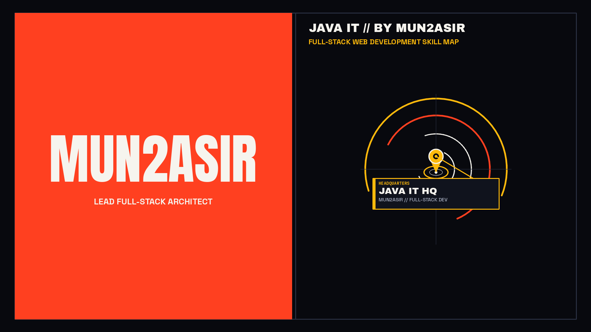
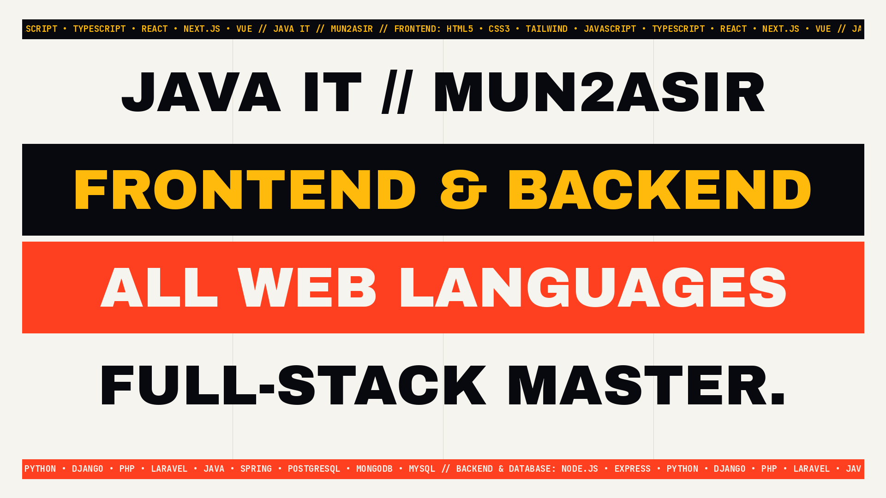
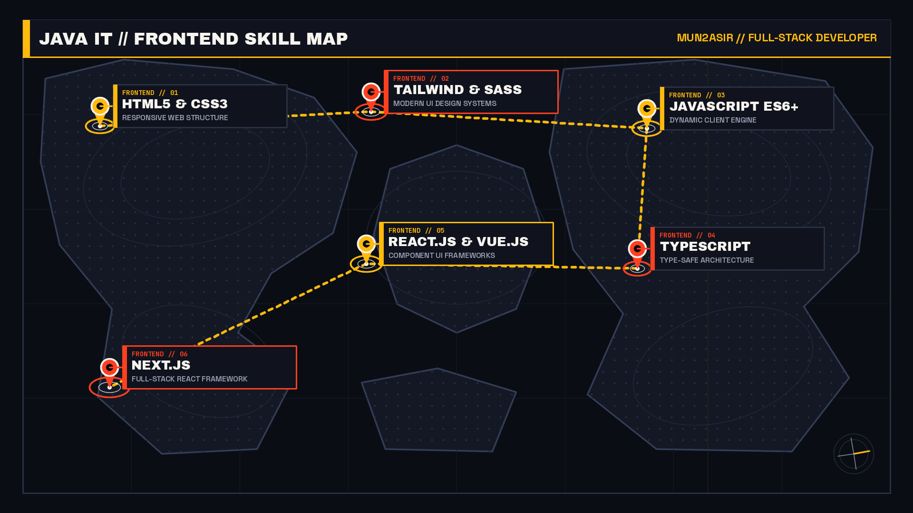
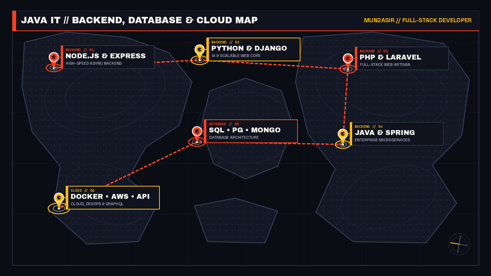
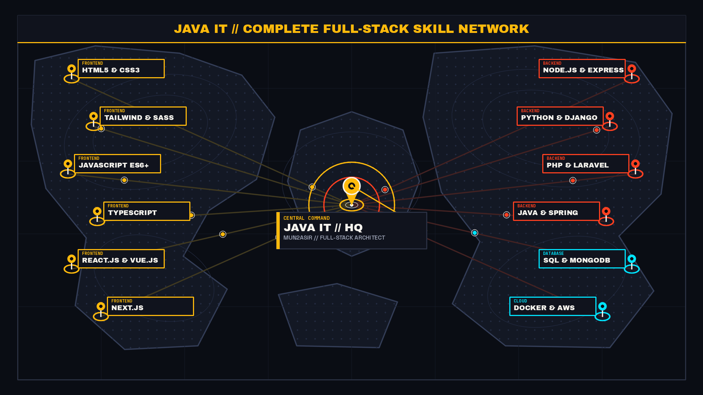
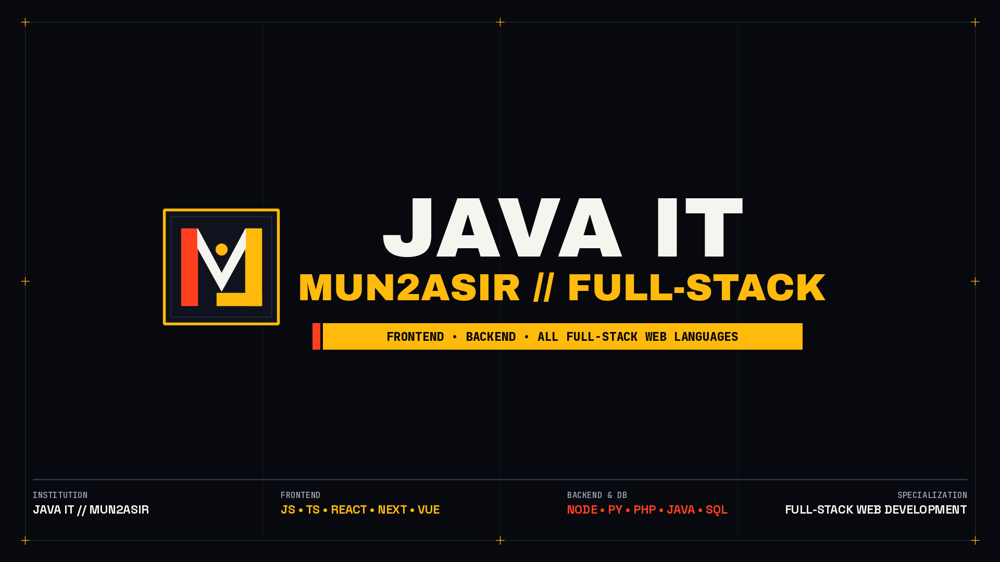

# JAVA IT // MUN2ASIR — 30s Full-Stack Skill Map Motion Design Video

Procedural **Full HD (`1920×1080` @ `60 FPS`) Motion Design & Cartographic Skill Map Video** built in Python (`NumPy`, `OpenCV`, `Pillow`, `SciPy`, `FFmpeg`) for **JAVA IT (by MUN2ASIR)**.

- **Rendered Video**: [`java_it_mun2asir_30s_skill_map.mp4`](./java_it_mun2asir_30s_skill_map.mp4)
- **Visual Theme**: Luxury Gold (`#FFBA0C`), Crimson Amber (`#FF4020`), and Deep Obsidian (`#08090E`)

---

## Scene Previews

### 1. Brand & Architect Intro


### 2. Full-Stack Web Manifesto


### 3. Frontend Skill Map (`HTML5 • CSS3 • Tailwind • JS • TS • React • Vue • Next.js`)


### 4. Backend, Database & Cloud Skill Map (`Node.js • Python • Django • PHP • Laravel • Java • Spring • SQL • MongoDB • Docker • AWS`)


### 5. Complete Full-Stack Skill Network Linked to JAVA IT HQ


### 6. Finale & Custom Logo Lockup


---

## Quick Start (Render Locally)

```bash
# 1. Install dependencies
pip install -r requirements.txt

# 2. Download required Google Fonts
./download_fonts.sh

# 3. Synthesize the 30-second stereo soundtrack
python3 generate_audio_30s.py

# 4. Render the 30-second 1080p60 MP4 video
python3 render_mun2asir_30s_map.py
```
